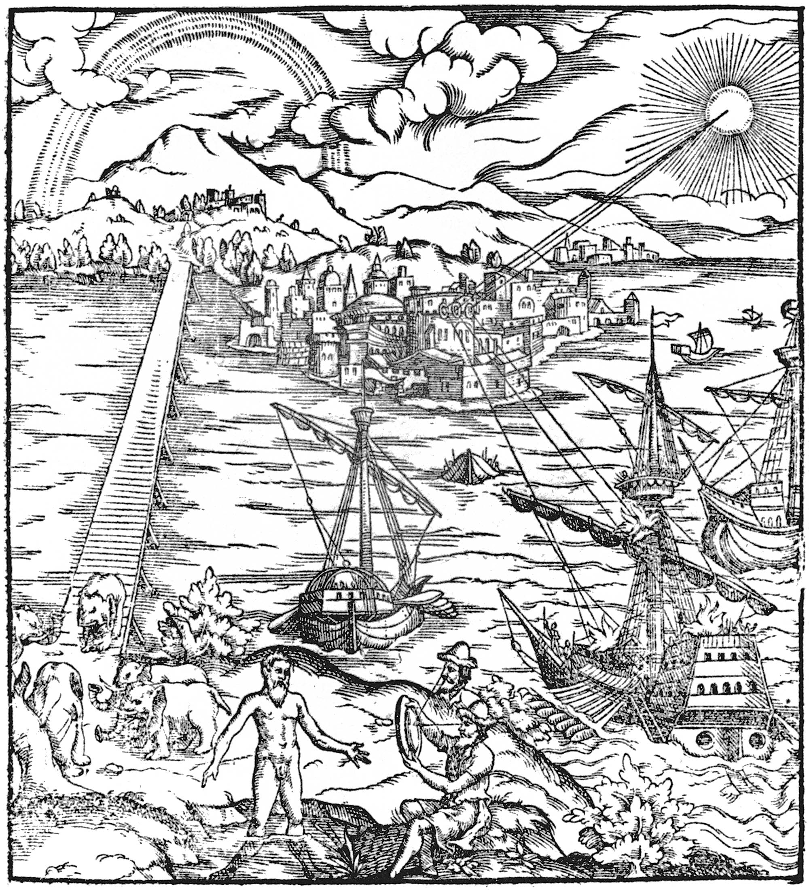

# Horopter

<p align="center"></p>

> *Horopter*: the set of points that both eyes see as one.

**Draft, not released.** Code: MIT (`LICENSE`). Weights, data recipe and docs: CC BY-NC-SA 4.0 (research, non-commercial). Weights: [horopter-0.4B](https://huggingface.co/jmccardle/horopter-0.4B), [horopter-1B](https://huggingface.co/jmccardle/horopter-1B) (beta 2, coming).

Horopter is an encoder-only *decision model*. Give it a **state** (a document, a record or a JSON object) and typed **questions** about it (yes/no, choose one, score on a scale). It answers them in one pass, and for every answer it also returns:

- **evidence:** whole-word spans in the state that support or refute each option;
- **relation:** whether the state bears on the question at all, and with what stance (support / refute / undetermined);
- **abstention:** a calibrated probability that the answer is wrong, with a reason (`unrelated`, `model_uncertainty`).

The state is encoded once, without seeing any question, and cached. Each question reads that cached state, so:
- adding a question never changes the answers to the others;
- asking many questions about one state costs about one encoding.

Built on [Ettin](https://huggingface.co/jhu-clsp/ettin-encoder-1b) encoders (400M and 1B), from Fight Fire with Fire Robotics.

## Status

| | beta (internal) | beta 2 |
|---|---|---|
| grounding (LLM-AggreFact balanced accuracy) | 75.7 (1B) | pending |
| 4-way relation (E0 macro-F1) | 78.6 | pending |
| multi-step policy decisions (JevBench hard) | 44.1 | pending |

Beta 2 adds generated rule-application data, counterfactual minimal pairs and deciding-rule evidence (see `docs/RELEASE_PLAN.md`).

## Layout

```
horopter/     model, packing, losses, runtime (adapters), evidence, abstention, server (typed wire format)
training/     joint trainer, adapter / evidence trainers, abstention head fit, data builders, recipes/beta2.md
eval/         benchmark scorers (E37 bench, E40 rule evals) and the HTTP client
scripts/      export_hf.py: training checkpoint -> HF layout
tests/        parity against the research code
docs/         release plan, porting notes (docs/PORTING.md)
assets/       theme art (public domain)
```

```python
import horopter
m = horopter.load("path/to/horopter-0.4B")      # the exported HF layout
out = m.answer("Refunds within 30 days. The lamp was bought 12 days ago.",
               {"q": {"type": "noul", "instructions": "Is a refund allowed?"}}, evidence=True)
```

Server: `python -m horopter.server --model path/to/horopter-0.4B --port 8420`.

## Credits

Title page of *Opticae thesaurus* (Friedrich Risner ed., Basel 1572), Bayerische Staatsbibliothek; public domain (Wikimedia Commons, `Thesaurus_opticus_Titelblatt.jpg`).
